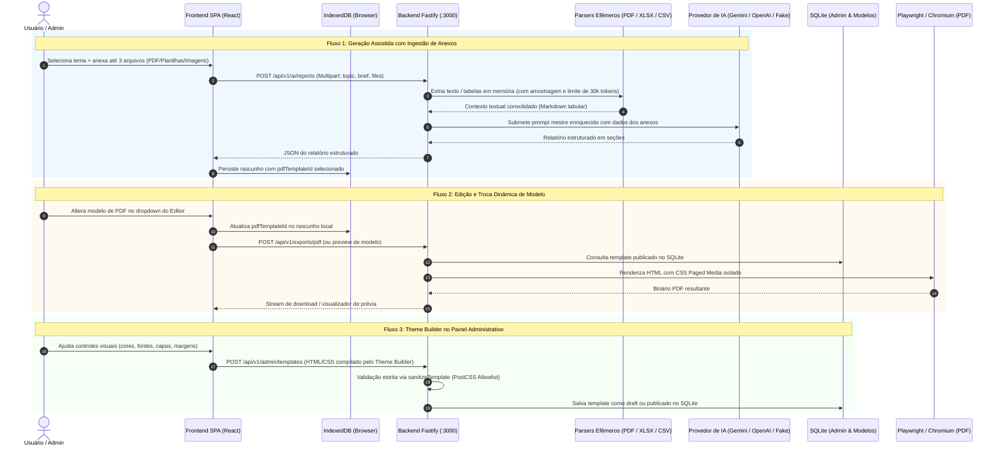

# Design Document: Evolução de Modelos PDF e Ingestão de Anexos para IA

* **Author:** Renato França
* **Date:** 2026-11-11
* **Status:** Draft / Em Elaboração
* **Iniciativa:** `00-anything/03 - evolucao de modelos e anexos 2026-11-11/`

---

## 1. The Problem (O Problema)

Atualmente, o gerador de relatórios apresenta três limitações funcionais e operacionais que restringem sua utilidade em cenários reais de análise de dados e personalização visual:

1. **Ausência de Contexto Baseado em Arquivos:** O fluxo de geração assistida por IA é puramente textual, aceitando apenas tema, objetivo, público e referências digitadas. Usuários que necessitam consolidar informações contidas em documentos já existentes (como relatórios contábeis em PDF, extratos de vendas em planilhas Excel/CSV ou gráficos em imagens) são forçados a transcrever manualmente os dados para os campos de texto, gerando atrito e risco de omissão de métricas vitais.
2. **Desconexão do Ciclo de Vida do Modelo PDF:** Embora o modal inicial permita a escolha de um modelo de PDF, o editor de relatório compartilhado (`ManualReportEditor`) não expõe o modelo selecionado de forma acionável e não permite trocá-lo durante o refinamento do conteúdo. Se o modelo configurado inicialmente não estiver publicado ou seu identificador não for transmitido com fidelidade no rascunho local, a API realiza fallback silencioso para o modelo padrão (`system-default`), gerando a percepção de que o modelo selecionado "não foi utilizado".
3. **Barreira Técnica na Criação de Modelos:** A criação de novos modelos PDF exige a escrita manual de HTML semântico e regras estritas de CSS compatíveis com a allowlist do PostCSS. Usuários e administradores sem conhecimento de desenvolvimento web não conseguem desenhar modelos visuais próprios e o sistema não fornece uma biblioteca pré-carregada de temas comerciais, executivos ou técnicos para clonagem e edição imediata.

---

## 2. Overview (Visão Geral)

Esta especificação define a arquitetura técnica para solucionar essas três frentes de forma coesa, mantendo o princípio de segurança e efemeridade de dados:

* **Ingestão Analítica Multimodal:** Implementação de suporte a upload temporário de até 3 arquivos combinados (PDF, XLSX, CSV, PNG, JPEG, WebP) com limite agregado de 15 MB. O backend extrai texto e estruturas tabulares em memória, amostra dados relevantes e os injeta estruturadamente no prompt do LLM como evidência factual, sem gravar arquivos em disco e sem reter dados do usuário no servidor.
* **Governança do Modelo no Editor:** Integração de um controle seletor de modelos PDF publicado diretamente na barra de cabeçalho do `ManualReportEditor`. A troca é persistida no `pdfTemplateId` do IndexedDB em tempo real e reflete imediatamente na prévia em PDF. Caso o modelo seja despublicado no servidor, o editor apresenta feedback visual transparente.
* **Bootstrap de Modelos Canônicos:** Provisionamento automático no banco de dados SQLite de 4 modelos de alta qualidade prontos para uso (Executivo Moderno, Técnico/Auditoria, Comercial/Vendas e Minimalista/Acadêmico), permitindo que sejam visualizados, duplicados e customizados no painel administrativo.
* **Construtor Visual Declarativo ("Theme Builder"):** Interface visual no `/admin` com formulário de propriedades de design (paleta de cores, tipografia permitida, layout de capa com/sem logo, margens de impressão `@page` e rodapé numerado), que compila deterministicamente para HTML e CSS estritamente validados pela allowlist existente, preservando o modo de código avançado para ajustes manuais.

---

## 3. Goals & Non-Goals

### In-Scope Goals (Metas em Escopo)
* **G1 — Upload e Extração Multipart:** Permitir envio de arquivos via `multipart/form-data` no endpoint de geração de IA, com extração de texto de PDFs (via parser em memória), amostragem tabular de planilhas CSV/XLSX (até 100 linhas por aba, máx. 200 linhas convertidas para Markdown) e suporte a imagens multimodais.
* **G2 — Teto de Tokens e Proteção de Quota:** Limitar o contexto documental extraído a aproximadamente 30.000 tokens (~120.000 caracteres), truncando graciosamente com aviso explícito ao usuário caso o material exceda o limite.
* **G3 — Efemeridade e Zero-PII:** Garantir que nenhum arquivo de contexto seja gravado no disco ou persistido no banco SQLite, e que logs do Fastify não exponham conteúdos textuais dos documentos.
* **G4 — Seletor Dinâmico no Editor:** Disponibilizar componente seletor no `ManualReportEditor` com listagem de templates publicados, atualização de rascunho no IndexedDB e feedback visual instantâneo na pré-visualização.
* **G5 — Catálogo de 4 Modelos Canônicos:** Incluir na inicialização do banco os modelos Executivo, Técnico, Comercial e Minimalista com status `published`.
* **G6 — Construtor Visual ("Theme Builder"):** Fornecer interface com controles visuais parametrizados no `/admin` que gere HTML/CSS válido e o submeta à validação `sanitizeTemplate`.

### Out-of-Scope Non-Goals (Fora de Escopo)
* **NG1 — Fusão Física de Arquivos Anexos:** Não será realizada a concatenação física dos arquivos PDF originais como apêndices no arquivo exportado. O relatório exportado é exclusivamente o produto formatado do template.
* **NG2 — OCR em Imagens e Documentos Escaneados:** Não haverá engine de OCR (Tesseract ou similar) embutida no servidor para ler PDFs que consistem unicamente em imagens rasterizadas sem camada de texto.
* **NG3 — Editor WYSIWYG de Coordenadas Livres:** Não será construído editor drag-and-drop de posicionamento absoluto tipo Canva/Figma, pois quebra a paginação natural orientada a CSS Paged Media do Chromium.

---

## 4. Technical Plan (Plano Técnico)

### 4.1 Arquitetura Geral & Fluxo de Dados

A arquitetura do sistema é expandida de maneira modular, preservando a separação estrita entre a camada client-side (SPA React) e o servidor em processo persistente (Fastify 5 + Node.js 24 LTS):

---

### 4.2 Pipeline de Ingestão Documental Efêmera

O endpoint `POST /api/v1/ai/reports` passa a aceitar requisições em `multipart/form-data` além do tradicional `application/json`:

1. **Campos do Formulário:**
   * Campo `payload` (texto/JSON): Objeto com `topic`, `brief`, `selectedFormats` e `pdfTemplateId`.
   * Campos `attachment:1`, `attachment:2`, `attachment:3` (binários): Arquivos enviados pelo usuário.
2. **Processamento em Fluxo (`request.parts()`):**
   * **Validação de Limites de Upload:** Máximo de 3 arquivos; limite individual de 10 MB para PDF e 5 MB para planilhas/imagens; limite cumulativo total de 15 MB.
   * **Parsing e Extração de PDF:** Utilização do parser `pdf-parse` diretamente no buffer em memória. O texto é sanitizado removendo caracteres de controle nulos e normalizando quebras de linha.
   * **Parsing de Planilhas (CSV e XLSX):**
     * Para CSV: Processamento via streaming com delimitadores comuns (vírgula, ponto-e-vírgula).
     * Para XLSX: Parsing em memória com teto de segurança contra *Decompression Bombs* (máx. 25 MB expandidos). Amostragem das primeiras 100 linhas por aba, limitadas a 200 linhas no total. Os dados tabulares são estruturados em tabelas Markdown com cabeçalhos de coluna explícitos.
   * **Imagens de Apoio:** Validadas e repassadas como partes multimodais para o Gemini/OpenAI ou convertidas em metadados contextuais.
3. **Truncamento de Contexto e Proteção de Token Quota:**
   * O total de texto extraído somado aos parâmetros de entrada é submetido a um teto rígido de 30.000 tokens estimados (~120.000 caracteres). Se exceder, o conteúdo documental é truncado ordenadamente preservando cabeçalhos e metadados, e um aviso informativo (`contextTruncated: true`) é retornado ao cliente.
4. **Efemeridade Absoluta:**
   * Nenhum buffer de arquivo é salvo em disco local ou banco SQLite. Ao final do processamento da requisição, as referências de buffer são liberadas para coleta imediata de lixo (GC).

---

### 4.3 Governança do Modelo no `ManualReportEditor`

1. **Integração na Interface:**
   * O cabeçalho e a barra de ações do editor exibem um dropdown reativo: `Modelo de PDF: [ Selecionar modelo ▼ ]`.
   * Ao carregar o editor, o componente consome a lista de modelos publicados (`fetchPublicTemplates`) e pré-seleciona o modelo indicado no `draft.pdfTemplateId`.
2. **Sincronização e Persistência no IndexedDB:**
   * A alteração do modelo dispara a atualização imediata da propriedade `pdfTemplateId` no IndexedDB através do serviço `saveReportDraft`.
   * O estado da pré-visualização (PDF viewer) é recarregado instantaneamente com o novo template sem necessidade de recarregar a página inteira.
3. **Resiliência a Modelos Removidos ou Despublicados:**
   * Se o `pdfTemplateId` associado ao rascunho for despublicado no servidor, a API responde `TEMPLATE_UNAVAILABLE` durante a exportação. O editor captura o erro e apresenta um modal/alerta informativo permitindo escolher qualquer outro modelo publicado atualmente, evitando que o rascunho seja perdido ou bloqueado.

---

### 4.4 Catálogo de Modelos Padrões Canônicos

A inicialização do banco SQLite em `createDatabase` (`api/database.js`) passa a efetuar o bootstrap automático de 4 modelos de alta qualidade com status `'published'` e versionamento inicial:

1. **Executivo Moderno (`system-executivo`):**
   * Layout corporativo contemporâneo com capa minimalista, barra lateral com acento de cor primária, tipografia sem serifa sóbria (Inter/Roboto), cabeçalho discreto com nome do documento e numeração elegante na margem inferior direita.
2. **Técnico / Auditoria (`system-tecnico`):**
   * Estrutura tabular e cartesiana, grade formal com metadados de versão/data, caixas de destaque com bordas sólidas para itens de "detalhes importantes" e separadores horizontais precisos.
3. **Comercial / Vendas (`system-comercial`):**
   * Tipografia expressiva para métricas e KPIs, destaque visual para tabelas de desempenho, cabeçalhos de seção com contraste e espaçamentos generosos entre blocos de conteúdo.
4. **Minimalista / Acadêmico (`system-minimalista`):**
   * Estilo editorial limpo em preto e branco, tipografia serifada (Merriweather), margens A4 amplas e confortáveis para leitura prolongada, sem elementos decorativos supérfluos.
5. **Clonagem e Duplicação no `/admin`:**
   * O painel administrativo ganha a ação "Duplicar Modelo" (`POST /api/v1/admin/templates/:id/clone`), permitindo ao administrador clonar qualquer modelo padrão para uma nova versão de rascunho (`draft`) e editá-la livremente sem alterar o template original.

---

### 4.5 Construtor Visual de Layouts ("Theme Builder")

Para eliminar a exigência de escrita manual de código para criar templates:

1. **Estrutura de Propriedades Visuais (Theme Config Schema):**
   * **Cores:** `primaryColor` (hex), `secondaryColor` (hex), `surfaceColor` (hex), `textColor` (hex).
   * **Tipografia:** `fontFamily` (enum: `inter`, `roboto`, `merriweather`, `courier`), `fontSizeBase` (10pt, 11pt, 12pt).
   * **Capa:** `coverLayout` (`centered`, `split-bar`, `none`), `showLogo` (boolean), `coverSubtitle` (string).
   * **Paginação e Margens:** `pageMargins` (normal: 20mm, estreita: 12mm, ampla: 25mm), `headerText` (string), `footerFormat` (`page-only`, `page-of-pages`, `date-and-page`).
2. **Compilação Determinística para Allowlist:**
   * Um compilador client-side / server-side mapeia a configuração visual para a estrutura canônica de HTML (`header`, `main`, `footer`, placeholders `{{report.title}}`, `{{report.sections}}`) e CSS Paged Media (`@page`, `@bottom-right`).
   * O CSS gerado passa obrigatoriamente pela validação estrita da função `sanitizeTemplate` antes de ser salvo no banco.
3. **Modo Duplo com Salvaguarda de Edição:**
   * O administrador pode alternar entre "Configurador Visual" e "Modo Avançado (HTML/CSS)".
   * Se o administrador realizar edições manuais no modo avançado de código, o sistema exibe um aviso claro de que o código manual passa a ter precedência e desativa a sobrescrita acidental pelo formulário visual.

---

## 5. Alternatives Considered (Alternativas Consideradas)

A concepção da solução avaliou e rejeitou quatro abordagens alternativas com base em restrições de arquitetura, segurança e experiência do usuário:

### 5.1 Concatenação Física de PDFs Brutos como Páginas Anexas no Final
* **Descrição:** Em vez de apenas extrair os dados para a IA sintetizar o relatório, o sistema receberia os arquivos PDF enviados pelo usuário e os fundiria (merge) fisicamente como apêndices ao final do arquivo PDF exportado.
* **Decisão:** `Rejected by author: Quebra a homogeneidade visual e tipográfica do modelo selecionado, introduz dependências adicionais de manipulação binária de PDF (como pdf-lib ou qpdf), dobra o tempo de resposta e consumo de memória na exportação, e desvia do propósito central do produto, que é produzir um relatório analítico unificado e coeso.`

### 5.2 Parsing e Extração de Documentos 100% no Navegador (Client-Side)
* **Descrição:** Executar o processamento e a extração de texto de PDFs e planilhas diretamente no navegador do usuário utilizando bibliotecas compiladas para JavaScript/Wasm (como PDF.js e SheetJS no bundle da SPA), enviando apenas o texto extraído para o endpoint da API.
* **Decisão:** `Rejected by author: Aumentaria significativamente o bundle inicial do Vite transferido aos usuários (~1.5 a 3 MiB a mais de scripts pesados) e geraria bloqueios na thread principal da interface do React ao descompactar planilhas grandes ou processar PDFs extensos em dispositivos com recursos limitados. A extração efêmera em streaming no backend Fastify oferece performance uniforme e mantém o cliente leve.`

### 5.3 Editor Visual WYSIWYG de Posicionamento Livre (Canvas / Arrasta-e-Solta)
* **Descrição:** Construir um editor visual estilo Canva ou Figma com coordenadas absolutas (`top`, `left` em pixels) onde o usuário pudesse arrastar caixas de texto, imagens e tabelas livremente sobre uma folha virtual.
* **Decisão:** `Rejected by author: O motor de geração de PDF do Chromium apoia-se em CSS Paged Media (@page, margens milimétricas de papel A4 e quebras de página automáticas break-inside / break-after). Posicionamento absoluto via coordenadas em tela quebra a paginação natural de relatórios que possuem volumes dinâmicos de seções e tabelas, provocando cortes acidentais de linhas e cabeçalhos em folhas subsequentes. A abordagem declarativa do Theme Builder garante 100% de previsibilidade de paginação.`

### 5.4 Persistência em Disco ou Object Storage dos Arquivos de Contexto
* **Descrição:** Armazenar os arquivos enviados pelo usuário em uma pasta temporária do servidor (`uploads/`) ou bucket S3 antes de realizar o processamento, mantendo um histórico dos documentos de referência.
* **Decisão:** `Rejected by author: Viola frontalmente o princípio de privacidade e zero-retenção de dados adotado pelo projeto, no qual o servidor não armazena conteúdos ou rascunhos de relatórios de usuários. Além disso, introduziria complexidade operacional de gerenciamento de ciclo de vida de arquivos, rotinas de limpeza periódica de uploads órfãos e riscos de vazamento de informações confidenciais.`

---

## 6. Detailed Implementation Plan (Plano de Implementação Detalhado)

Este plano unifica todas as modificações necessárias, organizadas por camadas funcionais, descrevendo cada arquivo afetado e a justificativa técnica das alterações.

### 6.1 Lista Única de Atividades e Roteiro de Execução

1. **Fase 1: Motor de Parsing Efêmero e Dependências**
   * Instalação de bibliotecas seguras e leves para descompressão e extração de texto em memória (`pdf-parse`, `xlsx` / `csv-parse`).
   * Criação do módulo [`api/parsers.js`](file:///c:/Users/renato.lima/Documents/00%20-%20Server/relatorios/relatorio/api/parsers.js) com extração de PDF, conversão tabular de CSV/XLSX para Markdown, limitação de até 100 linhas por aba (máx. 200 linhas totais), proteção contra *Decompression Bombs* (teto de 25 MB expandidos) e truncamento ordenado a ~30.000 tokens estimados.
2. **Fase 2: Expansão da API de IA e Provedores**
   * Atualização de `POST /api/v1/ai/reports` em [`api/app.js`](file:///c:/Users/renato.lima/Documents/00%20-%20Server/relatorios/relatorio/api/app.js) para aceitar `multipart/form-data` via `@fastify/multipart`, processando arquivos e payload de texto em streaming.
   * Encadeamento do `createRequestAbortSignal` para abortar imediatamente o parsing se a conexão do cliente for interrompida.
   * Ajuste do serviço de IA em [`api/ai.js`](file:///c:/Users/renato.lima/Documents/00%20-%20Server/relatorios/relatorio/api/ai.js) para incorporar as tabelas e textos extraídos no prompt mestre dos provedores Gemini, OpenAI e Fake (este último citando dados dos anexos para testes determinísticos).
3. **Fase 3: Seletor Dinâmico no Editor e Sincronização Local**
   * Modificação de [`src/components/ManualReportEditor/index.jsx`](file:///c:/Users/renato.lima/Documents/00%20-%20Server/relatorios/relatorio/src/components/ManualReportEditor/index.jsx) para incluir dropdown de modelos publicados no cabeçalho e na barra de ações.
   * Integração reativa com `saveReportDraft` para salvar a alteração de `pdfTemplateId` no IndexedDB e recarregar a visualização de prévia do PDF em tempo real.
   * Tratamento visual para modelo despublicado com fallback transparente para o modelo padrão sem corromper seções do rascunho.
4. **Fase 4: Catálogo de Modelos Canônicos e Ação de Clonagem**
   * Atualização do bootstrap de banco em [`api/database.js`](file:///c:/Users/renato.lima/Documents/00%20-%20Server/relatorios/relatorio/api/database.js) para inserir os 4 modelos iniciais (`system-executivo`, `system-tecnico`, `system-comercial`, `system-minimalista`) com status `published`.
   * Criação do endpoint `POST /api/v1/admin/templates/:id/clone` para duplicação de qualquer modelo publicado em uma nova versão editável (`draft`).
5. **Fase 5: Construtor Visual de Layouts ("Theme Builder")**
   * Criação do componente `ThemeBuilder.jsx` dentro de `src/components/AdminTemplateManager/` fornecendo controles visuais (cores, tipografia, layout de capa, logotipo, margens `@page` e formato de rodapé).
   * Compilação client-side das propriedades para HTML semântico e CSS PostCSS, com validação obrigatória via `sanitizeTemplate`.
   * Implementação de alternância entre o configurador visual e o modo de código avançado, com diálogo de confirmação.
6. **Fase 6: Interface de Upload no Formulário de IA**
   * Atualização de [`src/components/ReportGenerationForm/index.jsx`](file:///c:/Users/renato.lima/Documents/00%20-%20Server/relatorios/relatorio/src/components/ReportGenerationForm/index.jsx) com zona de upload (drag-and-drop e input) para até 3 arquivos / 15 MB cumulativos.
   * Validação client-side imediata e exibição de chips com tamanho e formato de cada arquivo.
7. **Fase 7: Testes e Governança**
   * Testes automatizados de contrato em [`tests/api/api.test.js`](file:///c:/Users/renato.lima/Documents/00%20-%20Server/relatorios/relatorio/tests/api/api.test.js) cobrindo upload multipart, limites de arquivos, cancelamento e clonagem de templates.
   * Testes funcionais E2E em [`tests/e2e/rotas.spec.js`](file:///c:/Users/renato.lima/Documents/00%20-%20Server/relatorios/relatorio/tests/e2e/rotas.spec.js) para a troca de modelo no editor e clonagem no `/admin`.
   * Atualização do [`AGENTS.md`](file:///c:/Users/renato.lima/Documents/00%20-%20Server/relatorios/relatorio/AGENTS.md), [`README.md`](file:///c:/Users/renato.lima/Documents/00%20-%20Server/relatorios/relatorio/README.md) e sincronização do grafo via `npm run graphify`.

---

### 6.2 Mapeamento Completo de Arquivos Afetados

| Arquivo | Ação | Justificativa Técnica |
| :--- | :--- | :--- |
| [`package.json`](file:///c:/Users/renato.lima/Documents/00%20-%20Server/relatorios/relatorio/package.json) | Modificar | Registrar dependências `pdf-parse` e `xlsx` (ou `csv-parse`) necessárias para a extração documental em memória. |
| [`api/parsers.js`](file:///c:/Users/renato.lima/Documents/00%20-%20Server/relatorios/relatorio/api/parsers.js) | Criar | Centralizar a lógica de extração segura de buffers em memória: parsing de PDF, amostragem de planilhas em Markdown tabular, proteção contra Zip Bombs e teto de tokens. |
| [`api/schemas.js`](file:///c:/Users/renato.lima/Documents/00%20-%20Server/relatorios/relatorio/api/schemas.js) | Modificar | Definir schemas de validação para a rota de clonagem de templates e para o payload de geração com anexos. |
| [`api/database.js`](file:///c:/Users/renato.lima/Documents/00%20-%20Server/relatorios/relatorio/api/database.js) | Modificar | Inserir bootstrap dos 4 modelos canônicos iniciais e implementar a função de duplicação `cloneTemplate`. |
| [`api/ai.js`](file:///c:/Users/renato.lima/Documents/00%20-%20Server/relatorios/relatorio/api/ai.js) | Modificar | Enriquecer o prompt mestre dos adaptadores Gemini, OpenAI e Fake com as tabelas e dados extraídos dos anexos. |
| [`api/app.js`](file:///c:/Users/renato.lima/Documents/00%20-%20Server/relatorios/relatorio/api/app.js) | Modificar | Habilitar multipart em `POST /api/v1/ai/reports`, encadear cancelamento no parser e registrar o endpoint `POST /api/v1/admin/templates/:id/clone`. |
| [`src/services/api.js`](file:///c:/Users/renato.lima/Documents/00%20-%20Server/relatorios/relatorio/src/services/api.js) | Modificar | Adaptar `generateReport` para envio de `FormData` multipart e expor função cliente `cloneAdminTemplate`. |
| [`src/components/ReportGenerationForm/index.jsx`](file:///c:/Users/renato.lima/Documents/00%20-%20Server/relatorios/relatorio/src/components/ReportGenerationForm/index.jsx) | Modificar | Adicionar zona de seleção de arquivos (drag-and-drop), tags informativas e validações client-side de limite de tamanho. |
| [`src/components/ReportGenerationForm/styles.js`](file:///c:/Users/renato.lima/Documents/00%20-%20Server/relatorios/relatorio/src/components/ReportGenerationForm/styles.js) | Modificar | Estilos styled-components (sufixo `Stl`) para a zona de upload e chips de arquivos. |
| [`src/components/ManualReportEditor/index.jsx`](file:///c:/Users/renato.lima/Documents/00%20-%20Server/relatorios/relatorio/src/components/ManualReportEditor/index.jsx) | Modificar | Inserir seletor de modelos publicados no cabeçalho/barra de ações, disparando persistência no IndexedDB e atualização da prévia. |
| [`src/components/ManualReportEditor/styles.js`](file:///c:/Users/renato.lima/Documents/00%20-%20Server/relatorios/relatorio/src/components/ManualReportEditor/styles.js) | Modificar | Estilos do dropdown de seleção de modelo no editor. |
| [`src/components/AdminTemplateManager/index.jsx`](file:///c:/Users/renato.lima/Documents/00%20-%20Server/relatorios/relatorio/src/components/AdminTemplateManager/index.jsx) | Modificar | Adicionar botão de clonagem de template e integrar o alternador para o novo Theme Builder. |
| `src/components/AdminTemplateManager/ThemeBuilder.jsx` | Criar | Interface visual declarativa para parametrização de cores, tipografia, capa e rodapé, compilando para HTML/CSS seguro. |
| `src/components/AdminTemplateManager/ThemeBuilder.styles.js` | Criar | Estilos dos controles e seletores do construtor de temas. |
| [`tests/api/api.test.js`](file:///c:/Users/renato.lima/Documents/00%20-%20Server/relatorios/relatorio/tests/api/api.test.js) | Modificar | Cobrir testes de upload de anexos, rejeição de limites de tamanho, cancelamento e clonagem de templates. |
| [`tests/e2e/rotas.spec.js`](file:///c:/Users/renato.lima/Documents/00%20-%20Server/relatorios/relatorio/tests/e2e/rotas.spec.js) | Modificar | Validar fluxo E2E de troca de modelo no editor e clonagem no painel `/admin`. |
| [`AGENTS.md`](file:///c:/Users/renato.lima/Documents/00%20-%20Server/relatorios/relatorio/AGENTS.md) | Modificar | Documentar os novos fluxos de anexo, bootstrap de templates e registrar histórico de governança. |
| [`README.md`](file:///c:/Users/renato.lima/Documents/00%20-%20Server/relatorios/relatorio/README.md) | Modificar | Atualizar capacidades do gerador com anexos multimodais e construtor visual de modelos. |

