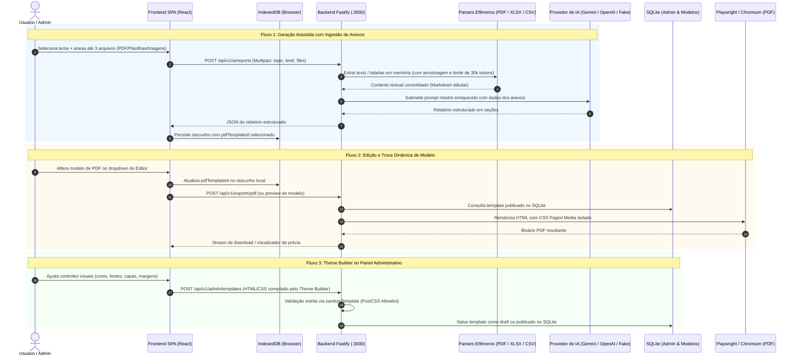

# RFC & Design Document: Evolução de Modelos PDF e Ingestão de Anexos para IA

* **Author:** Renato França
* **Date:** 2026-11-11
* **Status:** Aprovado / Pronto para Implementação
* **Iniciativa:** `00-anything/03 - evolucao de modelos e anexos 2026-11-11/`

---

## 1. The Problem (O Problema)

Atualmente, o gerador de relatórios apresenta três limitações funcionais e operacionais que restringem sua utilidade em cenários reais de análise de dados e personalização visual:

1. **Ausência de Contexto Baseado em Arquivos:** O fluxo de geração assistida por IA é puramente textual, aceitando apenas tema, objetivo, público e referências digitadas. Usuários que necessitam consolidar informações contidas em documentos já existentes (como relatórios contábeis em PDF, extratos de vendas em planilhas Excel/CSV ou gráficos em imagens) são forçados a transcrever manualmente os dados para os campos de texto, gerando atrito e risco de omissão de métricas vitais.
2. **Desconexão do Ciclo de Vida do Modelo PDF:** Embora o modal inicial permita a escolha de um modelo de PDF, o editor de relatório compartilhado (`ManualReportEditor`) não expõe o modelo selecionado de forma acionável e não permite trocá-lo durante o refinamento do conteúdo. Se o modelo configurado inicialmente não estiver publicado ou seu identificador não for transmitido com fidelidade no rascunho local, a API realiza fallback silencioso para o modelo padrão (`system-default`), gerando a percepção de que o modelo selecionado "não foi utilizado".
3. **Barreira Técnica na Criação de Modelos:** A criação de novos modelos PDF exige a escrita manual de HTML semântico e regras estritas de CSS compatíveis com a allowlist do PostCSS. Usuários e administradores sem conhecimento de desenvolvimento web não conseguem desenhar modelos visuais próprios e o sistema não fornece uma biblioteca pré-carregada de temas comerciais, executivos ou técnicos para clonagem e edição imediata.

---

## 2. Overview (Visão Geral)

Esta especificação define a arquitetura técnica para solucionar essas três frentes de forma coesa, mantendo o princípio de segurança e efemeridade de dados:

* **Ingestão Analítica Multimodal:** Implementação de suporte a upload temporário de até 3 arquivos combinados (PDF, XLSX, CSV, PNG, JPEG, WebP) com limite agregado de 15 MB. O backend extrai texto e estruturas tabulares em memória, amostra dados relevantes e os injeta estruturadamente no prompt do LLM como evidência factual, sem gravar arquivos em disco e sem reter dados do usuário no servidor.
* **Governança do Modelo no Editor:** Integração de um controle seletor de modelos PDF publicado diretamente na barra de cabeçalho do `ManualReportEditor`. A troca é persistida no `pdfTemplateId` do IndexedDB em tempo real e reflete imediatamente na prévia em PDF. Caso o modelo seja despublicado no servidor, o editor apresenta feedback visual transparente.
* **Bootstrap de Modelos Canônicos:** Provisionamento automático no banco de dados SQLite de 4 modelos de alta qualidade prontos para uso (Executivo Moderno, Técnico/Auditoria, Comercial/Vendas e Minimalista/Acadêmico), permitindo que sejam visualizados, duplicados e customizados no painel administrativo.
* **Construtor Visual Declarativo ("Theme Builder"):** Interface visual no `/admin` com formulário de propriedades de design (paleta de cores, tipografia permitida, layout de capa com/sem logo, margens de impressão `@page` e rodapé numerado), que compila deterministicamente para HTML e CSS estritamente validados pela allowlist existente, preservando o modo de código avançado para ajustes manuais.

---

## 3. Goals & Non-Goals

### In-Scope Goals (Metas em Escopo)
* **G1 — Upload e Extração Multipart:** Permitir envio de arquivos via `multipart/form-data` no endpoint de geração de IA, com extração de texto de PDFs (via parser em memória), amostragem tabular de planilhas CSV/XLSX (até 100 linhas por aba, máx. 200 linhas convertidas para Markdown) e suporte a imagens multimodais.
* **G2 — Teto de Tokens e Proteção de Quota:** Limitar o contexto documental extraído a aproximadamente 30.000 tokens (~120.000 caracteres), truncando graciosamente com aviso explícito ao usuário caso o material exceda o limite.
* **G3 — Efemeridade e Zero-PII:** Garantir que nenhum arquivo de contexto seja gravado no disco ou persistido no banco SQLite, e que logs do Fastify não exponham conteúdos textuais dos documentos.
* **G4 — Seletor Dinâmico no Editor:** Disponibilizar componente seletor no `ManualReportEditor` com listagem de templates publicados, atualização de rascunho no IndexedDB e feedback visual instantâneo na pré-visualização.
* **G5 — Catálogo de 4 Modelos Canônicos:** Incluir na inicialização do banco os modelos Executivo, Técnico, Comercial e Minimalista com status `published`.
* **G6 — Construtor Visual ("Theme Builder"):** Fornecer interface com controles visuais parametrizados no `/admin` que gere HTML/CSS válido e o submeta à validação `sanitizeTemplate`.

### Out-of-Scope Non-Goals (Fora de Escopo)
* **NG1 — Fusão Física de Arquivos Anexos:** Não será realizada a concatenação física dos arquivos PDF originais como apêndices no arquivo exportado. O relatório exportado é exclusivamente o produto formatado do template.
* **NG2 — OCR em Imagens e Documentos Escaneados:** Não haverá engine de OCR (Tesseract ou similar) embutida no servidor para ler PDFs que consistem unicamente em imagens rasterizadas sem camada de texto.
* **NG3 — Editor WYSIWYG de Coordenadas Livres:** Não será construído editor drag-and-drop de posicionamento absoluto tipo Canva/Figma, pois quebra a paginação natural orientada a CSS Paged Media do Chromium.

---

## 4. Technical Plan (Plano Técnico)

### 4.1 Arquitetura Geral & Fluxo de Dados

### 4.2 Pipeline de Ingestão Documental Efêmera
* **Validação de Uploads:** Máximo de 3 arquivos; limite individual de 10 MB para PDF e 5 MB para planilhas/imagens; limite cumulativo total de 15 MB.
* **Parsing e Extração de PDF:** Utilização do parser `pdf-parse` diretamente no buffer em memória.
* **Parsing de Planilhas (CSV e XLSX):** Proteção contra *Decompression Bombs* (teto de 25 MB expandidos). Amostragem das primeiras 100 linhas por aba (máx. 200 linhas totais) convertidas para Markdown tabular.
* **Truncamento de Contexto:** Teto rígido de ~30.000 tokens estimados (~120.000 caracteres) com aviso `contextTruncated: true`.
* **Efemeridade:** Zero gravação em disco ou banco SQLite. Descarte imediato pós-IA.

### 4.3 Governança do Modelo no `ManualReportEditor`
* Dropdown reativo no cabeçalho e na barra de ações consumindo `fetchPublicTemplates`.
* Sincronização em tempo real de `pdfTemplateId` com o IndexedDB e recarregamento da prévia.
* Tratamento visual gracioso para modelos despublicados.

### 4.4 Catálogo de 4 Modelos Canônicos no SQLite
* Inserção dos templates `system-executivo`, `system-tecnico`, `system-comercial` e `system-minimalista` com status `'published'`.
* Endpoint administrativo `POST /api/v1/admin/templates/:id/clone` para duplicação segura.

### 4.5 Construtor Visual de Layouts ("Theme Builder")
* Interface visual com propriedades declarativas (cores hex, enum de fontes, layout de capa, logotipo, margens `@page` e rodapé numerado).
* Compilação determinística com validação estrita via `sanitizeTemplate`.
* Modo duplo (Visual e Código Avançado) com diálogo de confirmação de precedência.

---

## 5. Alternatives Considered (Alternativas Consideradas)

* **Concatenação Física de PDFs:** `Rejected by author: Quebra a homogeneidade visual, adiciona sobrecarga de binários de PDF e desvia do propósito analítico do relatório.`
* **Parsing 100% no Navegador:** `Rejected by author: Aumentaria o bundle da SPA em 1.5–3 MB e travaria a UI em dispositivos móveis.`
* **Editor WYSIWYG de Canvas Livre:** `Rejected by author: Incompatível com o modelo de paginação de páginas A4 do CSS Paged Media no Chromium.`
* **Persistência dos Arquivos em Disco:** `Rejected by author: Viola a promessa de privacidade e zero-retenção de dados do projeto.`

---

## 6. Detailed Implementation Plan (Plano de Implementação Detalhado)

### Mapeamento Completo de Arquivos Afetados

| Arquivo | Ação | Justificativa Técnica |
| :--- | :--- | :--- |
| [`package.json`](file:///c:/Users/renato.lima/Documents/00%20-%20Server/relatorios/relatorio/package.json) | Modificar | Dependências `pdf-parse` e `xlsx` (ou `csv-parse`) para extração em memória. |
| [`api/parsers.js`](file:///c:/Users/renato.lima/Documents/00%20-%20Server/relatorios/relatorio/api/parsers.js) | Criar | Módulo de extração de buffers: PDF, planilhas em Markdown tabular, proteção contra Zip Bombs e teto de tokens. |
| [`api/schemas.js`](file:///c:/Users/renato.lima/Documents/00%20-%20Server/relatorios/relatorio/api/schemas.js) | Modificar | Schemas de validação para clonagem de templates e payload multipart de geração com anexos. |
| [`api/database.js`](file:///c:/Users/renato.lima/Documents/00%20-%20Server/relatorios/relatorio/api/database.js) | Modificar | Bootstrap dos 4 modelos canônicos iniciais e função `cloneTemplate`. |
| [`api/ai.js`](file:///c:/Users/renato.lima/Documents/00%20-%20Server/relatorios/relatorio/api/ai.js) | Modificar | Injeção estruturada do contexto dos anexos nos provedores Gemini, OpenAI e Fake. |
| [`api/app.js`](file:///c:/Users/renato.lima/Documents/00%20-%20Server/relatorios/relatorio/api/app.js) | Modificar | Habilitar multipart em `POST /api/v1/ai/reports`, encadear cancelamento no parser e registrar rota de clonagem. |
| [`src/services/api.js`](file:///c:/Users/renato.lima/Documents/00%20-%20Server/relatorios/relatorio/src/services/api.js) | Modificar | Adaptar `generateReport` para `FormData` e expor `cloneAdminTemplate`. |
| [`src/components/ReportGenerationForm/index.jsx`](file:///c:/Users/renato.lima/Documents/00%20-%20Server/relatorios/relatorio/src/components/ReportGenerationForm/index.jsx) | Modificar | Zona de upload drag-and-drop para até 3 arquivos / 15 MB com chips e validação client-side. |
| [`src/components/ReportGenerationForm/styles.js`](file:///c:/Users/renato.lima/Documents/00%20-%20Server/relatorios/relatorio/src/components/ReportGenerationForm/styles.js) | Modificar | Estilos dos componentes de upload e chips de arquivo. |
| [`src/components/ManualReportEditor/index.jsx`](file:///c:/Users/renato.lima/Documents/00%20-%20Server/relatorios/relatorio/src/components/ManualReportEditor/index.jsx) | Modificar | Dropdown de seleção de modelo no cabeçalho/ações, persistindo no IndexedDB e atualizando a prévia. |
| [`src/components/ManualReportEditor/styles.js`](file:///c:/Users/renato.lima/Documents/00%20-%20Server/relatorios/relatorio/src/components/ManualReportEditor/styles.js) | Modificar | Estilos do seletor de modelos no editor. |
| [`src/components/AdminTemplateManager/index.jsx`](file:///c:/Users/renato.lima/Documents/00%20-%20Server/relatorios/relatorio/src/components/AdminTemplateManager/index.jsx) | Modificar | Ação de clonagem e alternância para o Theme Builder. |
| `src/components/AdminTemplateManager/ThemeBuilder.jsx` | Criar | Construtor visual declarativo (cores, fontes, capa, margens, rodapé) compilando para HTML/CSS seguro. |
| `src/components/AdminTemplateManager/ThemeBuilder.styles.js` | Criar | Estilos styled-components do Theme Builder. |
| [`tests/api/api.test.js`](file:///c:/Users/renato.lima/Documents/00%20-%20Server/relatorios/relatorio/tests/api/api.test.js) | Modificar | Testes de upload de anexos, limites de tamanho, cancelamento e clonagem de modelos. |
| [`tests/e2e/rotas.spec.js`](file:///c:/Users/renato.lima/Documents/00%20-%20Server/relatorios/relatorio/tests/e2e/rotas.spec.js) | Modificar | Testes E2E de troca de modelo no editor e clonagem no `/admin`. |
| [`AGENTS.md`](file:///c:/Users/renato.lima/Documents/00%20-%20Server/relatorios/relatorio/AGENTS.md) | Modificar | Documentar arquitetura, endpoints e histórico de governança. |
| [`README.md`](file:///c:/Users/renato.lima/Documents/00%20-%20Server/relatorios/relatorio/README.md) | Modificar | Atualizar capacidades e instruções para os novos recursos. |
